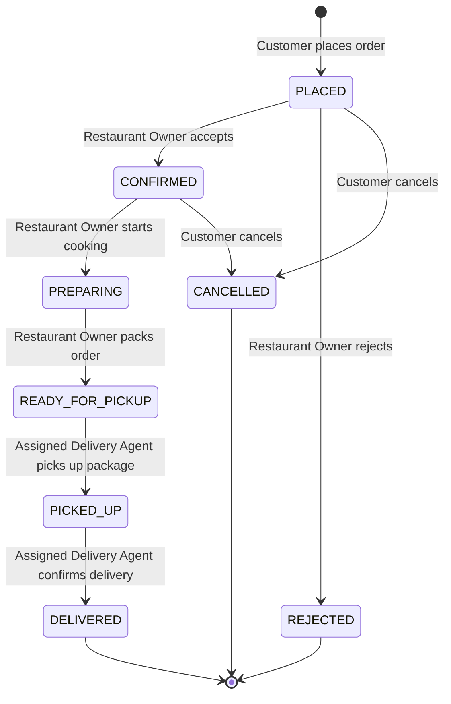

# Order Lifecycle State Machine

## Overview
The Food Delivery Order Management System strictly enforces an auditable, deterministic finite state machine (FSM). Any transition outside of this validated specification is rejected with **HTTP 409 Conflict**. Every permitted status change creates an immutable audit row in `order_status_history` containing timestamp, initiator, old status, new status, and optional remarks.

## Valid State Transitions

## Transition Matrix & Role Enforcement

| From Status | To Status | Authorized Actor | HTTP Method & Route | Business Conditions |
|---|---|---|---|---|
| `*` (Initial) | `PLACED` | `CUSTOMER` | `POST /orders` | Restaurant must be open; menu items available & not deleted; totals computed server-side. |
| `PLACED` | `CONFIRMED` | `RESTAURANT_OWNER` | `PATCH /orders/{id}/status` | Order belongs to owner's restaurant. |
| `PLACED` | `REJECTED` | `RESTAURANT_OWNER` | `PATCH /orders/{id}/status` | Terminal state; kitchen at capacity or out of stock. |
| `PLACED` | `CANCELLED` | `CUSTOMER` | `PATCH /orders/{id}/cancel` | Customer can self-cancel while still in early phase. |
| `CONFIRMED` | `PREPARING` | `RESTAURANT_OWNER` | `PATCH /orders/{id}/status` | Kitchen starts preparation. |
| `CONFIRMED` | `CANCELLED` | `CUSTOMER` | `PATCH /orders/{id}/cancel` | Customer can still cancel prior to preparation. |
| `PREPARING` | `READY_FOR_PICKUP` | `RESTAURANT_OWNER` | `PATCH /orders/{id}/status` | Order is packaged and waiting for pickup. |
| `READY_FOR_PICKUP` | `READY_FOR_PICKUP` | `ADMIN` | `PATCH /orders/{id}/assign-agent` | Admin assigns an active `DELIVERY_AGENT` to order. |
| `READY_FOR_PICKUP` | `PICKED_UP` | `DELIVERY_AGENT` | `PATCH /orders/{id}/delivery-status` | **Strict Rule:** Only the agent assigned to this order can transition to `PICKED_UP`. Customer phone becomes visible. |
| `PICKED_UP` | `DELIVERED` | `DELIVERY_AGENT` | `PATCH /orders/{id}/delivery-status` | **Strict Rule:** Only assigned agent. Sets `delivered_at` timestamp. Enables rating endpoint. |

## Terminal States
- `DELIVERED`: Order fulfilled. Eligible for 1-5 star customer ratings.
- `REJECTED`: Order turned down by restaurant.
- `CANCELLED`: Order aborted by customer.
No further transitions are permitted from these states. Any attempt to update returns `HTTP 409 Conflict`.
